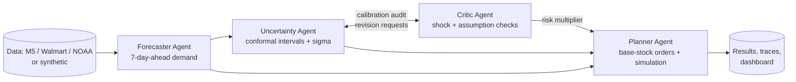

# Agentic Demand Forecasting & Inventory Optimization

A multi-agent system that turns demand forecasts **and their uncertainty** into reorder decisions,
and stays robust when demand shocks (promotions, holidays, weather, sudden surges) break classical models.

> Capstone project #4 - "Agentic Demand Forecasting & Inventory Optimization System".

## The idea in one picture



| Agent | Responsibility | Code |
|---|---|---|
| **Forecaster** | Leakage-safe features, gradient-boosting model, compares against seasonal-naive | `agents/forecaster.py` |
| **Uncertainty** | Split-conformal prediction intervals, per-forecast sigma, reliability scores | `agents/uncertainty.py` |
| **Critic** | Audits interval coverage (can demand a revision), flags events / abnormal weather / error drift, outputs a risk multiplier | `agents/critic.py` |
| **Planner** | Order-up-to levels = expected demand + z x sigma x risk; simulates three policies | `agents/planner.py` |
| Orchestrator | Runs the agents, manages the Critic-Uncertainty revision loop | `orchestrator.py` |

Every thought, action, observation, message and decision is written to `outputs/<run>/traces.jsonl`
(the brief requires logged reasoning traces).

## Quick start

**In Google Colab (no installation):** open `notebooks/colab_runner.ipynb` in Colab, choose `Runtime -> Run all`, and upload
`agentic-demand-forecasting.zip` when asked. It runs the pipeline, shows the tables, an interactive forecast explorer, the
report figures and the traces, and can download everything as a zip. Flags at the top switch on the experiments and the
real M5 / Walmart data (needs a free Kaggle token).

**On your own machine:**

```bash
pip install -e ".[dashboard,report,dev]"   # or: pip install -r requirements.txt
python scripts/run_pipeline.py             # ~25 s on the built-in synthetic data
streamlit run dashboard/app.py             # 8-tab dashboard (calibration, what-if planner, traces ...)
pytest -q                                  # 37 tests
python scripts/run_experiments.py all      # multi-seed robustness + sensitivity sweeps (~2 min)
python scripts/make_report_figures.py      # PNG figures for the report
python scripts/build_report.py             # auto-drafted report with the numbers filled in
python scripts/export_trace_review.py      # sheet for the qualitative review of agent traces
```

Options: `--source m5` (real data, see `docs/data_guide.md`), `--config config/walmart.yaml` (weekly mode),
`--baselines seasonal_naive ets arima`, `--service-level 0.97`, `--output-dir outputs/my_run`.
All settings live in `config/default.yaml`. The code is tested on current and on older library versions (pandas 2.2).

## What the pipeline compares

Five policies replay the same held-out test window with the same demand, as a **ladder** so each agent's
contribution can be separated:

| Policy | Forecast | Safety stock | Adds |
|---|---|---|---|
| `classical_ets` | Holt-Winters ETS | static, from one-step residuals | the classical baseline |
| `gbm_static` | Gradient boosting | static, from validation residuals | **better forecasts** |
| `gbm_calibrated` | Gradient boosting | calibrated sigma, corrected for multi-day error correlation | **Uncertainty agent** |
| `agentic_risk` | Gradient boosting | calibrated sigma x Critic risk multiplier | **Critic shock detection** |
| `agentic` | Gradient boosting, re-centred by the Planner | as above | **nowcast correction** when recent demand is significantly off the forecast |

The Forecaster also chooses, on held-out validation data, between the gradient-boosting model, a blend with ETS, and seasonal
naive (a blend is only used if it beats the plain model by 2%). Optional Planner features: random supplier delays, order
batches and minimum order quantity, an (s, S) rule with a fixed order cost, per-item service levels, a lead-time buffer.

## Results

All numbers in this section are on **synthetic data with known shocks** (calm worlds and shock worlds). Real-data results are in
the next section.

### How the Critic learns (the fix for the real-data weakness)

On the first real M5 run the Critic's warning signs did not predict bigger forecast errors, but its hand-set weights (tuned on
synthetic data) still added stock. Now the Critic **learns each weight from validation errors**: a signal that fires often but does
not predict larger errors is pushed towards zero; a signal that never fires on validation keeps its hand-set prior
(`critic.learn_weights`, `critic.prior_strength`). The nowcast trigger was also made stricter (z > 3.0 instead of 2.0, i.e. about
0.3% instead of 4.5% false alarms per period).

**Stock needed for the same service, relative to the plain `gbm_static` policy** (1.00 = same, below 1.00 = less stock; mean over 5
fresh seeds 401-405 that were not used for tuning; `python scripts/run_experiments.py frontier`):

| World | `agentic` before the change | `agentic` now | `agentic_risk` now |
|---|---|---|---|
| Calm (no shocks, like the M5 pilot window) | 1.082 (+8% stock) | **1.019 (+2%)** | 1.013 |
| With shocks (heatwave, surge, event) | 0.954 (-5%) | **0.917 (-8%)** | 0.952 |

So the agentic policy is now close to harmless when nothing happens and clearly more efficient when shocks hit.
This has **not yet been verified on real M5 data**; rerun the M5 notebook with the new files.

### Five-policy ladder (mean +/- std over 5 independent synthetic worlds, seeds 101-105)

| Policy | Fill rate | Stockout rate | Avg stock | Total cost |
|---|---|---|---|---|
| classical_ets | 92.6% +/- 1.0 | 11.2% | 17.9 | 9,431 +/- 1,956 |
| gbm_static | 95.1% +/- 0.8 | 8.6% | 16.0 | 6,321 +/- 1,484 |
| gbm_calibrated | 95.4% +/- 0.8 | 7.9% | 16.4 | 5,928 +/- 1,540 |
| agentic_risk | 96.2% +/- 0.7 | 6.7% | 17.5 | 4,965 +/- 1,425 |
| **agentic** | **97.2% +/- 0.6** | **5.6%** | 18.6 | **3,684 +/- 840** |

These compare policies at one service-level *setting*. A policy that holds more stock looks better there, so use the equal-service
comparison above and below for claims.

| Forecast WAPE (lower is better) | all | normal days | shock days |
|---|---|---|---|
| seasonal naive | 0.489 | 0.508 | 0.450 |
| ETS (classical) | 0.378 | 0.373 | 0.389 |
| **agentic forecast** | **0.313** | **0.302** | **0.335** |

Prediction intervals (90% target): coverage 89.0% overall, 91.3% on normal days, 79.5% on shock days (event 90.8%, heatwave 85.3%,
**surge 62.2%**). Critic: precision 60%, recall 80%. (Shock-day coverage is slightly lower than before the change because the learned
weights widen the intervals less.)

**Equal-service comparison on the default seed** (`sensitivity_frontier.csv`, average stock needed for the same fill rate):

| Fill rate | gbm_static | gbm_calibrated | classical_ets | agentic_risk | agentic |
|---|---|---|---|---|---|
| ~93% | 11.6 | 11.6 | 21.0 | 11.3 | **10.9** |
| ~95% | 15.3 | 15.1 | not reached | 14.4 | **13.8** |
| ~97% | 20.6 | 19.6 | not reached | 18.3 | **17.3** |

**Sensitivity, synthetic data** (`python scripts/run_experiments.py sensitivity`): the agentic policy has the lowest total cost at
all six tested service levels (80-99.5%), all seven lead times (0-6) and all nine holding-rate x stockout-cost combinations.
Absolute costs move a lot with the cost parameters, so replace the placeholder values (`docs/assumptions.md`).

**Weekly mode** (`config/walmart.yaml`, Walmart-format synthetic data, dollar sales): agentic fill rate 99.0% vs 98.2% for
classical ETS and total cost 4.4M vs 7.5M. The forecast blend is *not* more accurate than ETS there (WAPE 0.057 vs 0.054, ETS
adapts faster to the unobserved surge); the gains come from the Planner layers.

## Results on real data: M5 pilot (first run, no weather, BEFORE the Critic fix above)

Pilot subset: 3 California stores x the 50 highest-volume items, last 56 days as the test window, run in Google Colab. One run,
so treat the numbers as indicative. **These were produced before the Critic learned its weights; rerun to see the effect.**

| Forecast WAPE (lower is better) | all | normal days | days flagged by the Critic |
|---|---|---|---|
| seasonal naive | 0.412 | 0.406 | 0.438 |
| ETS (classical) | 0.341 | 0.338 | 0.353 |
| gradient boosting only | 0.336 | 0.331 | 0.356 |
| **agentic forecast (blend chosen on validation)** | **0.323** | **0.320** | **0.338** |

| Policy (one service-level setting) | Fill rate | Avg stock | Total cost |
|---|---|---|---|
| classical_ets | 97.8% | 28.8 | 3,541 |
| gbm_static | 97.7% | 27.3 | 3,458 |
| gbm_calibrated | 98.5% | 33.4 | 2,319 |
| agentic_risk | 98.9% | 39.9 | 1,802 |
| agentic | 99.0% | 41.1 | 1,753 |

**Fair comparison (average stock needed to reach the same fill rate, lower is better):**

| Fill rate | gbm_static | gbm_calibrated | classical_ets | agentic_risk | agentic |
|---|---|---|---|---|---|
| 97.7% | **27.4** | 27.5 | 28.6 | 29.1 | 29.5 |
| 98.7% | **34.7** | 35.5 | 35.8 | 37.0 | 37.2 |
| 99.2% | not reached | **43.5** | not reached | 45.9 | 45.6 |

**What this honestly shows.**
- The forecasting gain is real but modest (about 5% lower WAPE than ETS, mostly from the validation-chosen blend).
- The lower costs of the later policies at a fixed setting come from **holding more stock**, which gives a higher fill rate. At
  the *same* fill rate the Critic and nowcast layers need slightly **more** stock than the simple policies, not less. The
  calibrated policies can reach very high fill rates (99.2%) that the static and classical policies cannot reach within the
  tested service levels, which is the genuine benefit seen here.
- This pilot window has few unexplained shocks and no weather data, so the Critic and nowcast have little to catch. They
  were designed for, and helped in, the synthetic worlds with injected shocks (see above). **Report both results, and do not claim the
  shock layers help on M5 until they show it on equal-fill terms.**
- Always compare policies at equal fill rate; total cost at one service-level setting favours whichever policy holds
  more stock, because the placeholder holding cost is small next to the stockout cost.

## Known limitations (read before presenting)

1. **Real data was run only once (M5 pilot, no weather).** Walmart real data and the weather merge are still untested. M5 and Walmart
   cannot be downloaded in the build environment; the Colab notebook downloads them once you add a Kaggle token.
2. **Surges stay under-covered.** Errors are only observable after the forecast horizon, so intervals cover only ~62% of
   outcomes in a sudden unobserved surge. The Planner's nowcast reduces the *inventory* damage, not the interval gap.
3. **The agentic advantage is not uniform.** On synthetic data it shows at high service levels and during shocks. On the real M5
   pilot it did **not** show at equal fill rate (see the section above).
4. **Weather-sensitivity detection has less power for very low-volume items** (pooled across stores to help).
5. **Synthetic worlds share one generator**, and the shocks are our own design. Multi-seed runs show stability, not
   realism. The Critic's weights were tuned on synthetic data and must be re-tuned on real validation data.
6. **The Critic fix is verified only on synthetic calm and shock worlds, not yet on real data.** The learned weights shrink the
   risk multipliers a lot (e.g. the drift weight from 1.25 to ~0.1 on the default seed), which is right when errors do not persist but
   lowers shock-day interval coverage a little.
7. **Cost and lead-time values are placeholders** (`docs/assumptions.md`); sweeps show the ranking is robust, not the absolute costs.
8. **The NOAA download script could not be run against the live service here** (network restricted); its parser is
   unit-tested.
9. Walmart weekly data is store-total dollar sales, so "units" there are dollars of sales volume (a value-based proxy).
10. **Qualitative evaluation needs people:** `scripts/export_trace_review.py` prepares the rating sheet; nobody has rated it yet.

## Project structure

```
agentic-demand-forecasting/
├── config/default.yaml        # all experiment settings (walmart.yaml: weekly mode, inherits default)
├── data/                      # raw/ and processed/ (git-ignored); see docs/data_guide.md
├── src/demand_agents/
│   ├── data/                  # synthetic.py, loaders.py (M5, Walmart, NOAA), features.py, splits.py
│   ├── models/                # gbm.py, baselines.py (seasonal naive, ETS, ARIMA), uncertainty.py
│   ├── inventory/             # policies.py (base-stock), simulator.py
│   ├── agents/                # forecaster, uncertainty, critic, planner, state, base
│   ├── evaluation/            # metrics.py, report.py
│   ├── orchestrator.py        # pipeline + revision loop
│   ├── experiments.py         # multi-seed suite, replanning, sensitivity sweeps, efficiency frontier
│   ├── tracing.py             # reasoning-trace logger (JSONL)
│   └── llm.py                 # optional Claude-written rationales (off by default)
├── notebooks/colab_runner.ipynb   # run everything in Google Colab
├── scripts/                   # run_pipeline, run_experiments, make_report_figures, build_report, export_trace_review, fetch_noaa_weather
├── dashboard/app.py           # Streamlit dashboard (overview, forecasts, calibration, what-if planner, traces ...)
├── tests/                     # leakage, simulator, conformal, agents, loaders
└── docs/                      # architecture, data_guide, assumptions, trace_review, team_tasks (+ CONTRIBUTING.md, CI in .github/)
```

## Design decisions worth knowing

- **No leakage by construction:** forecasts are 7 days ahead, so every sales-derived feature is lagged >= 7 days
  (a test enforces it). Weather is treated as a known forecast.
- **Protection interval <= horizon:** with lead time 2 and review period 1 the Planner needs 3 days of forecast,
  which the 7-day-ahead model provides. The Planner raises an error if this is violated.
- **Honest baselines:** ETS/ARIMA are refit weekly (rolling origin) and forecast 1-7 days ahead, which is
  slightly easier than the 7-day-ahead GBM, so the comparison is conservative.
- **LLM is optional:** the numbers never depend on it. Set `llm.enabled: true` and `ANTHROPIC_API_KEY` to have
  the Planner phrase its summary with Claude.

## Team

See `docs/team_tasks.md` for the per-member task board (data, forecasting, uncertainty, critic and
evaluation, inventory planning, integration and delivery).
